> Architecture update: see [ARCHITECTURE_REBUILD.md](ARCHITECTURE_REBUILD.md) for the shared API envelope, current-account authentication, profiles, and container tests.

# System Design — Multi-Tenant SaaS Billing & Subscription Engine

Complete structural and behavioural documentation: UML models, data-flow diagrams, and a
step-by-step narration of every path through the system.

All diagrams are Mermaid and render natively on GitHub/GitLab. In an IDE, use the
Mermaid preview plugin.

---

## Table of contents

1. [Notation legend](#1-notation-legend)
2. [System context — DFD Level 0](#2-system-context--dfd-level-0)
3. [Deployment view](#3-deployment-view)
4. [UML — package structure](#4-uml--package-structure)
5. [UML — domain class diagram](#5-uml--domain-class-diagram)
6. [UML — application layer class diagram](#6-uml--application-layer-class-diagram)
7. [UML — security and multi-tenancy class diagram](#7-uml--security-and-multi-tenancy-class-diagram)
8. [UML — messaging class diagram](#8-uml--messaging-class-diagram)
9. [Entity-relationship model](#9-entity-relationship-model)
10. [DFD Level 1 — the whole system](#10-dfd-level-1--the-whole-system)
11. [DFD Level 2.1 — tenant onboarding](#111-dfd-level-21--tenant-onboarding)
12. [DFD Level 2.2 — authentication and request admission](#112-dfd-level-22--authentication-and-request-admission)
13. [DFD Level 2.3 — subscription lifecycle](#113-dfd-level-23--subscription-lifecycle)
14. [DFD Level 2.4 — usage capture](#114-dfd-level-24--usage-capture-producer-side)
15. [DFD Level 2.5 — usage ingestion](#115-dfd-level-25--usage-ingestion-consumer-side)
16. [DFD Level 2.6 — invoicing](#116-dfd-level-26--invoicing)
17. [Sequence diagrams](#12-sequence-diagrams)
18. [State machines](#13-state-machines)
19. [Multi-tenant isolation walkthrough](#14-multi-tenant-isolation-walkthrough)
20. [Application startup sequence](#15-application-startup-sequence)
21. [Error handling flow](#16-error-handling-flow)
22. [Data dictionary](#17-data-dictionary)

---

## 1. Notation legend

### Data-flow diagrams

Mermaid has no native DFD type, so Yourdon–DeMarco elements are mapped onto flowchart shapes:

| DFD element | Meaning | Shape used here |
|---|---|---|
| **External entity** | Actor or system outside the boundary; source/sink of data | `[Rectangle]` |
| **Process** | A transformation of data, numbered `n.m` | `((Circle))` |
| **Data store** | Persistent or durable data at rest, labelled `Dn` | `[(Cylinder)]` |
| **Data flow** | Movement of data, labelled with what moves | `-->` with label |
| **Trust boundary** | Subgraph enclosing the application | `subgraph` |

Every process is numbered. `1.0` denotes a Level-1 process; `1.1`, `1.2` … denote its
Level-2 decomposition.

### UML

Standard UML 2.5 notation. In class diagrams:

- `<|--` generalisation (extends) · `<|..` realisation (implements)
- `*--` composition · `o--` aggregation · `-->` directed association · `..>` dependency
- `<<interface>>`, `<<record>>`, `<<enumeration>>`, `<<abstract>>` stereotypes
- Multiplicities on association ends: `"1"`, `"0..1"`, `"0..*"`

---

## 2. System context — DFD Level 0

The single-process view of the entire engine and everything it talks to.

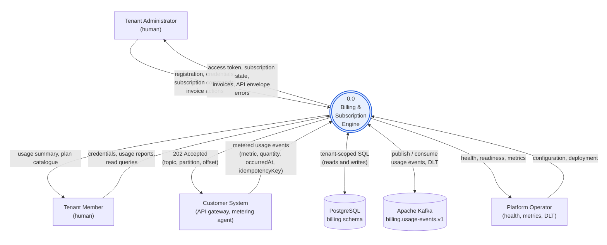

### Context boundary — what is in and what is out

| Actor / system | Role | Inside boundary? |
|---|---|---|
| Tenant Administrator | Manages subscriptions, invoices; full control of own tenant | No |
| Tenant Member | Reports usage, reads own tenant's data | No |
| Customer System | Machine client reporting metered consumption | No |
| PostgreSQL | System of record for all billing state | Yes (owned) |
| Apache Kafka | Durable buffer for the usage pipeline | Yes (owned) |
| Payment gateway | **Not integrated.** `markPaid` records state only | Out of scope |
| Renewal scheduler | **Not wired.** Repository support exists | Out of scope |

---

## 3. Deployment view

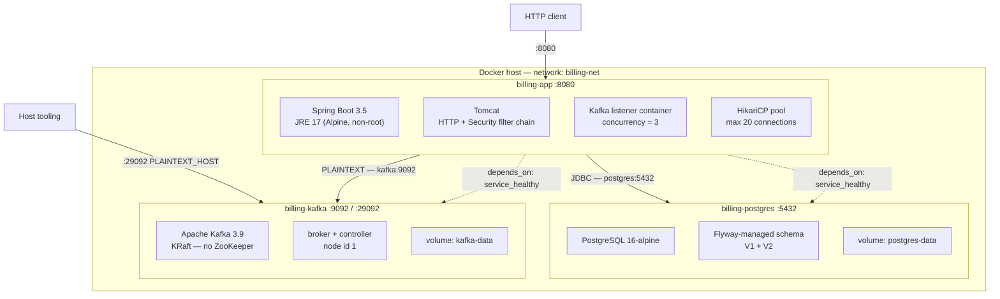

**Startup ordering.** `app` waits on both health checks. Without that gate Flyway would race
an unready database, and the listener container would attach to a broker still forming its
KRaft quorum.

---

## 4. UML — package structure

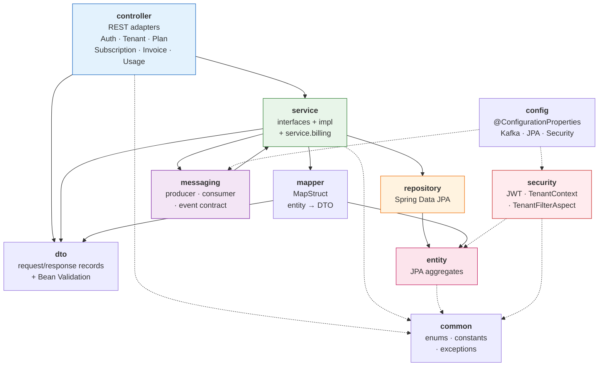

**Dependency rule.** Arrows point inward/downward only. `entity` depends on nothing but
`common` and `security` (for the tenant stamp). `controller` never reaches `repository`
directly. `messaging` calls into `service`, never the reverse for ingestion — the producer is
the one exception, and it is injected into `service` as an outbound port.

---

## 5. UML — domain class diagram

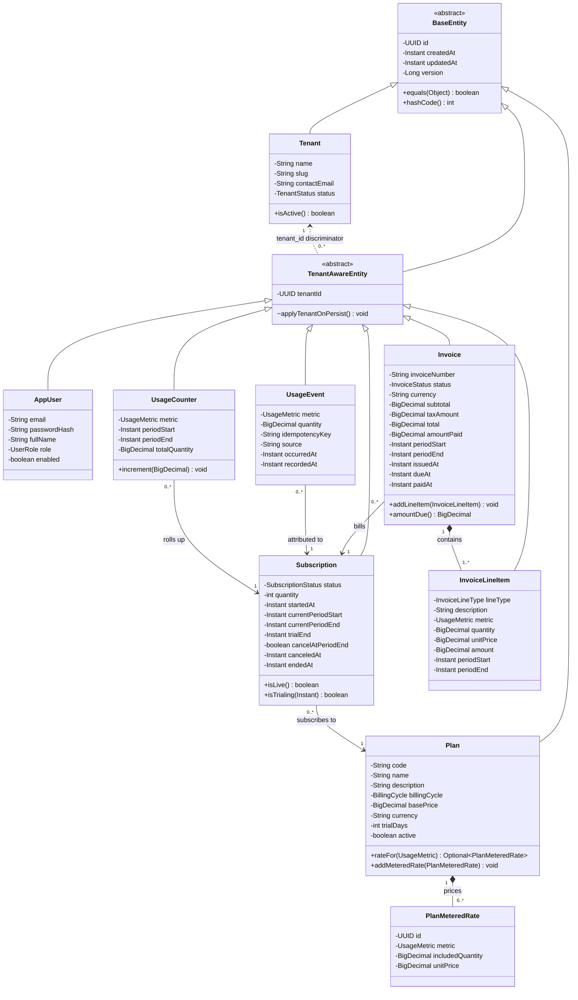

### Design notes carried by this model

| Element | Why it is shaped this way |
|---|---|
| `TenantAwareEntity` | Everything tenant-scoped inherits `tenantId` + the `@PrePersist` stamp + the `@FilterDef`. A new entity is isolated by extending one class. |
| `Tenant` extends `BaseEntity`, not `TenantAwareEntity` | The tenant **is** the discriminator; it cannot carry a foreign one. |
| `Plan` extends `BaseEntity` | Plans are a platform-wide catalogue, offered to every tenant. Per-tenant copies would make a price change an N-row migration. |
| `Invoice *-- InvoiceLineItem` | Composition: a line has no existence outside its invoice (`cascade = ALL`, `orphanRemoval = true`). |
| `Plan *-- PlanMeteredRate` | Same composition; rates are a value collection of the plan. |
| `UsageCounter` | A materialised roll-up of `UsageEvent`, so invoicing is O(metrics) instead of O(events). |
| `version` on `BaseEntity` | Plan change and invoice settlement are read-modify-write on the same aggregate; a lost update mis-bills a customer. |

### Enumerations

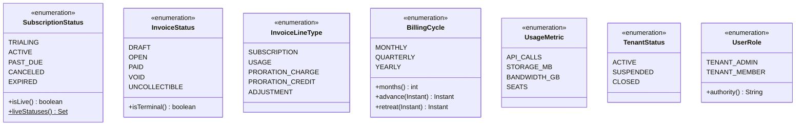

---

## 6. UML — application layer class diagram

```mermaid
classDiagram
    class AuthService {
        <<interface>>
        +register(RegisterTenantRequest) AuthResponse
        +login(LoginRequest) AuthResponse
    }
    class SubscriptionService {
        <<interface>>
        +create(CreateSubscriptionRequest) SubscriptionResponse
        +changePlan(UUID, ChangePlanRequest) SubscriptionResponse
        +cancel(UUID, CancelSubscriptionRequest) SubscriptionResponse
        +get(UUID) SubscriptionResponse
        +list(Pageable) PageResponse
    }
    class InvoiceService {
        <<interface>>
        +generateForCurrentPeriod(UUID) InvoiceResponse
        +get(UUID) InvoiceResponse
        +list(InvoiceStatus, Pageable) PageResponse
        +markPaid(UUID) InvoiceResponse
    }
    class UsageService {
        <<interface>>
        +record(RecordUsageRequest) UsageAcceptedResponse
        +currentPeriodSummary(UUID) UsageSummaryResponse
    }
    class UsageIngestionService {
        <<interface>>
        +ingest(UsageEventMessage) void
    }
    class PlanService {
        <<interface>>
        +listActivePlans() List
        +getByCode(String) PlanResponse
    }
    class TenantService {
        <<interface>>
        +currentTenant() TenantResponse
    }

    class AuthServiceImpl
    class SubscriptionServiceImpl
    class InvoiceServiceImpl
    class UsageServiceImpl
    class UsageIngestionServiceImpl
    class PlanServiceImpl
    class TenantServiceImpl

    class ProrationCalculator {
        -MathContext RATIO_CONTEXT$
        -BillingProperties billingProperties
        +calculate(Subscription, Plan, int, Instant) ProrationResult
        -remainingRatio(Instant, Instant, Instant) BigDecimal
    }
    class ProrationResult {
        <<record>>
        +BigDecimal creditAmount
        +BigDecimal chargeAmount
        +BigDecimal netAmount
        +BigDecimal remainingRatio
        +Instant effectiveAt
        +Instant periodEnd
        +isCharge() boolean
        +isZero() boolean
    }
    class InvoiceAssembler {
        +openInvoice(Subscription, Instant, Instant) Invoice
        +addSubscriptionLine(Invoice, Subscription) void
        +addUsageLines(Invoice, Subscription, Collection) void
        +addProrationLines(Invoice, Subscription, Plan, int, ProrationResult) void
        +finalise(Invoice) Invoice
        +nextInvoiceNumber() String
    }
    class BillingPeriodResolver {
        -int MAX_STEPS$
        +resolve(Subscription, Instant) BillingPeriod
    }
    class BillingPeriod {
        <<record>>
        +Instant start
        +Instant end
        +contains(Instant) boolean
    }

    AuthService <|.. AuthServiceImpl
    SubscriptionService <|.. SubscriptionServiceImpl
    InvoiceService <|.. InvoiceServiceImpl
    UsageService <|.. UsageServiceImpl
    UsageIngestionService <|.. UsageIngestionServiceImpl
    PlanService <|.. PlanServiceImpl
    TenantService <|.. TenantServiceImpl

    SubscriptionServiceImpl --> ProrationCalculator
    SubscriptionServiceImpl --> InvoiceAssembler
    InvoiceServiceImpl --> InvoiceAssembler
    UsageIngestionServiceImpl --> BillingPeriodResolver
    ProrationCalculator ..> ProrationResult : creates
    BillingPeriodResolver ..> BillingPeriod : creates
    InvoiceAssembler ..> ProrationResult : consumes
```

**Why `service.billing` exists.** Two independent flows produce invoices — the periodic
billing run and an immediate proration settlement on a plan change. Both must agree on
numbering, rounding, tax and due dates. `InvoiceAssembler` is the single place that knows how
an invoice is put together; duplicating that across two services is how two subtly different
definitions of "total" end up in one system.

### MapStruct mapper hierarchy

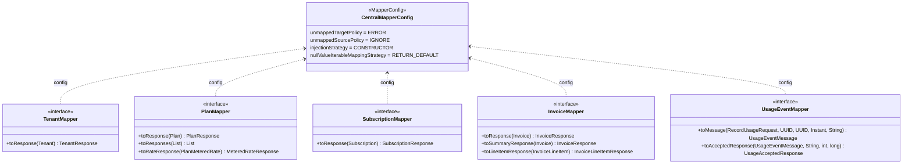

Mappers are **read-side only**. Entities are constructed explicitly in services, because
building an aggregate involves invariants — period arithmetic, status transitions, tenant
stamping — that a field-by-field mapper cannot express. `unmappedTargetPolicy = ERROR` turns
"someone added a response field and forgot to wire it" into a compile error rather than a
`null` in a billing payload.

`UsageEventMapper.toMessage` takes `tenantId` and `subscriptionId` as **separate parameters**,
not from the request body. That signature is what makes it impossible for a client to report
usage against another tenant.

---

## 7. UML — security and multi-tenancy class diagram

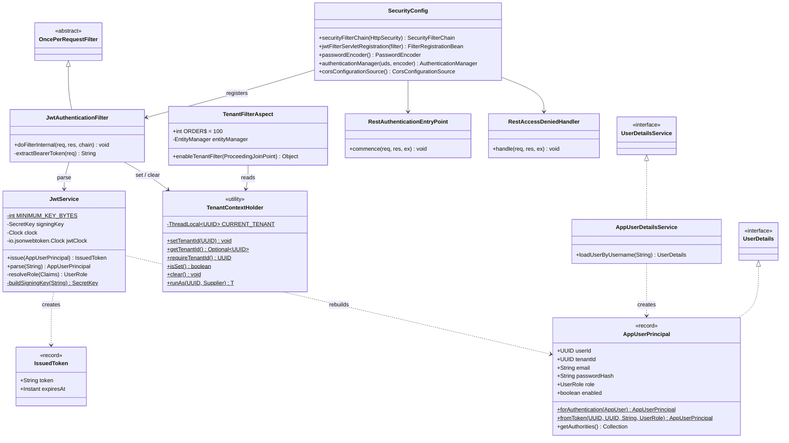

### The three layers of tenant isolation

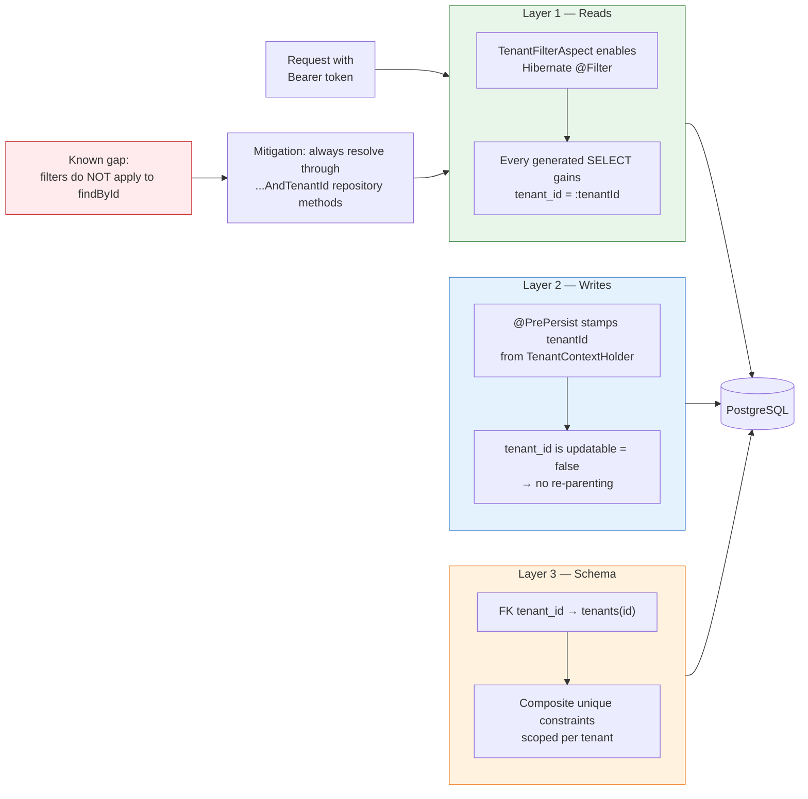

**Verified SQL.** With Postgres statement logging on, a subscription lookup emits:

```sql
select s1_0.id from subscriptions s1_0
where s1_0.tenant_id = $1        -- Layer 1: Hibernate @Filter
  and s1_0.tenant_id = $2        -- Layer 2: explicit ...AndTenantId predicate
  and s1_0.status in ($3,$4,$5)
fetch first $6 rows only
```

**Advice ordering is load-bearing.** `@EnableTransactionManagement(order = 0)` keeps the
transaction interceptor *outside* `TenantFilterAspect` (`@Order(100)`). Reversed, the aspect
would enable the filter on a session the transaction then replaces — a silent, total loss of
isolation with no error anywhere.

---

## 8. UML — messaging class diagram

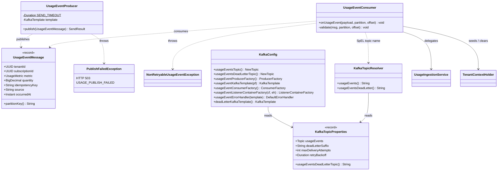

**Why the message carries its own `tenantId`.** A consumer thread has no HTTP request and
therefore no inherited `TenantContext`. The payload is the only trustworthy source of tenancy
at that point — and it was written by the authenticated producer side, from a verified claim.

---

## 9. Entity-relationship model

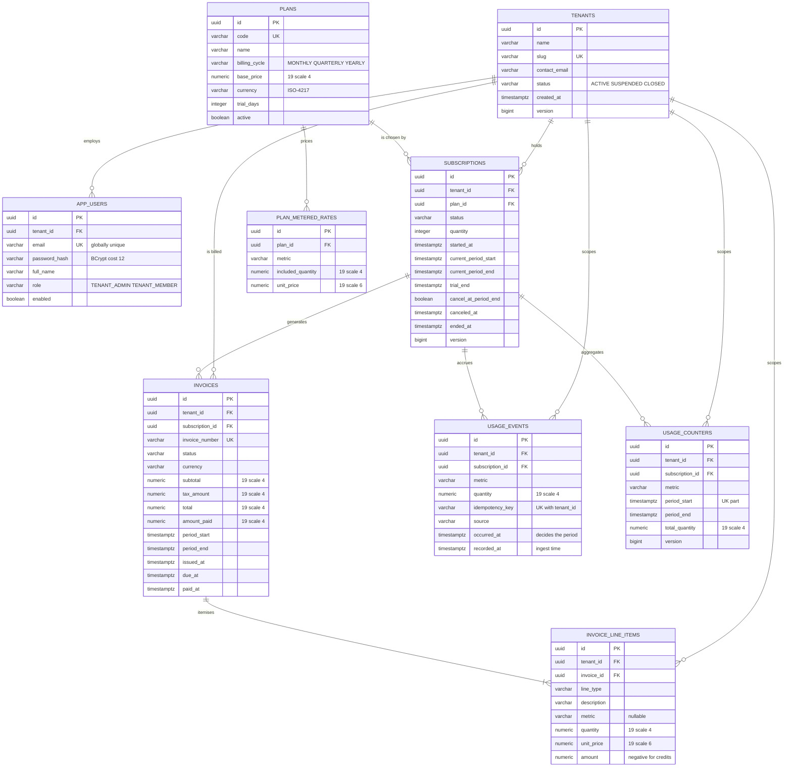

### Constraints that carry business rules

| Constraint | Rule it enforces |
|---|---|
| `uk_subscriptions_one_live_per_tenant` — partial unique index on `tenant_id` `WHERE status IN ('TRIALING','ACTIVE','PAST_DUE')` | A tenant may hold at most one live subscription, even under concurrent requests |
| `uk_usage_events_idempotency` — unique `(tenant_id, idempotency_key)` | At-least-once Kafka redelivery cannot double-charge |
| `uk_usage_counters` — unique `(subscription_id, metric, period_start)` | Exactly one roll-up row per metric per period |
| `uk_app_users_email` — globally unique | Login can resolve the tenant before one is known |
| `uk_invoices_number` | Document numbers are unique across the platform |
| `ck_subscriptions_period` — `current_period_end > current_period_start` | No degenerate period can reach the proration maths |
| `invoice_number_seq` | Transaction-independent numbering; concurrent billing runs cannot collide |

**Money columns are `NUMERIC(19,4)`** and are only ever read into `BigDecimal`. Per-unit prices
use `NUMERIC(19,6)` because they are frequently fractions of a cent (e.g. `$0.000150` per API
call); rounding to two decimals happens once, on the resulting line amount.

---

## 10. DFD Level 1 — the whole system

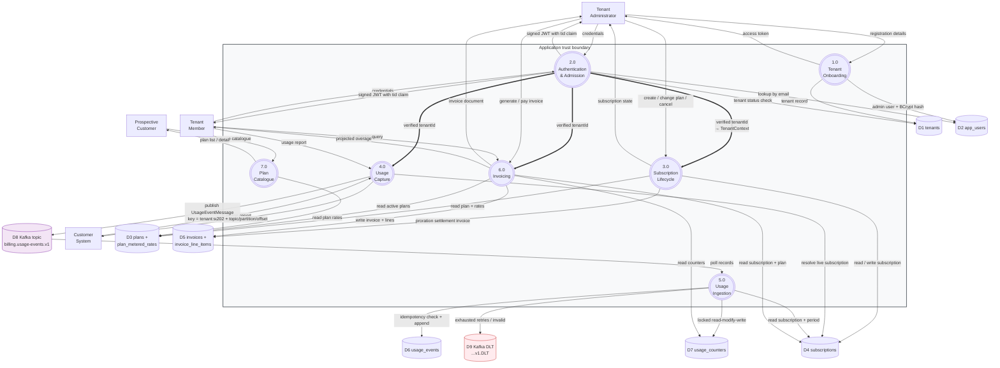

### Level-1 process register

| # | Process | Trigger | Reads | Writes | Output |
|---|---|---|---|---|---|
| 1.0 | Tenant Onboarding | `POST /auth/register` | D1, D2 (uniqueness) | D1, D2 | Access token |
| 2.0 | Authentication & Admission | `POST /auth/login`, then every request | D2, D1 | — | JWT / `TenantContext` |
| 3.0 | Subscription Lifecycle | `POST /subscriptions`, `/change-plan`, `/cancel` | D3, D4 | D4, D5 | Subscription state |
| 4.0 | Usage Capture | `POST /usage/events` | D4 | D8 | 202 Accepted |
| 5.0 | Usage Ingestion | Kafka poll | D8, D4 | D6, D7, D9 | (none — async) |
| 6.0 | Invoicing | `POST /invoices/generate`, `/pay`, summary query | D3, D4, D7, D5 | D5 | Invoice / summary |
| 7.0 | Plan Catalogue | `GET /plans` | D3 | — | Plan list |

---

## 11. Level-2 decompositions

### 11.1 DFD Level 2.1 — Tenant onboarding

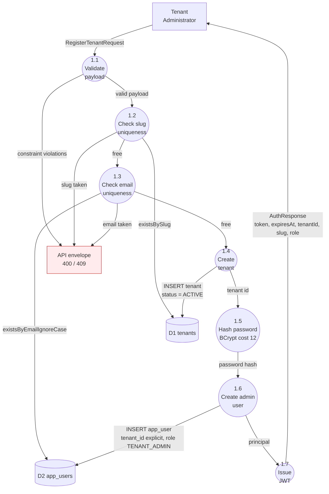

**Step by step**

| Step | Action | Detail |
|---|---|---|
| 1.1 | Bean Validation on `RegisterTenantRequest` | Slug must match `^[a-z0-9]+(-[a-z0-9]+)*$`; password 12–72 chars (BCrypt truncates past 72 bytes) |
| 1.2 | `tenantRepository.existsBySlug` | Failure → `DuplicateResourceException` → **409** |
| 1.3 | `appUserRepository.existsByEmailIgnoreCase` | Failure → **409** |
| 1.4 | Insert `Tenant` with `status = ACTIVE` | Hibernate assigns the UUID before insert |
| 1.5 | `passwordEncoder.encode` | BCrypt strength 12 (~250 ms — invisible per login, expensive to brute-force) |
| 1.6 | Insert `AppUser` | `tenantId` set **explicitly**: the request is not authenticated, so no `TenantContext` exists to read from |
| 1.7 | `jwtService.issue` | Claims: `sub`, `iss`, `iat`, `exp`, `jti`, `tid`, `roles`, `email` |

Steps 1.4 and 1.6 run in **one transaction**. A tenant with no administrator is unreachable —
nobody could ever log in — and would need manual cleanup.

---

### 11.2 DFD Level 2.2 — Authentication and request admission

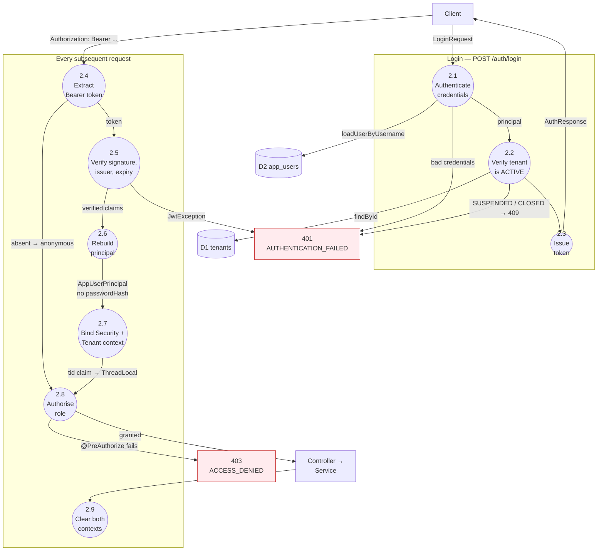

**Step by step**

| Step | Action | Detail |
|---|---|---|
| 2.1 | `AuthenticationManager.authenticate` | `DaoAuthenticationProvider` with `hideUserNotFoundExceptions = true` — uniform timing so the endpoint is not an account-enumeration oracle |
| 2.2 | Tenant status gate | Login and every bearer-authenticated request check current tenant status |
| 2.3 | Mint HS256 JWT | 30-minute TTL limits token lifetime; current account and tenant state are checked on every request |
| 2.4 | Read `Authorization` header | Missing/blank → proceed anonymously; the authorization filter yields the 401 |
| 2.5 | `Jwts.parser().verifyWith(key).requireIssuer(...).clock(jwtClock)` | Signature verified **before** any claim is read. Clock is injected, so expiry is deterministic and testable |
| 2.6 | Build `AppUserPrincipal` from claims | **No database read** — this is what keeps request handling free of a round trip |
| 2.7 | Set `SecurityContextHolder` **and** `TenantContextHolder` | Both from the same verified token |
| 2.8 | `@PreAuthorize("hasRole('TENANT_ADMIN')")` on mutations | Reads are open to any authenticated tenant member |
| 2.9 | `finally` → clear both | **Load-bearing.** Tomcat reuses request threads; a leaked tenant would be inherited by an unrelated later request |

---

### 11.3 DFD Level 2.3 — Subscription lifecycle

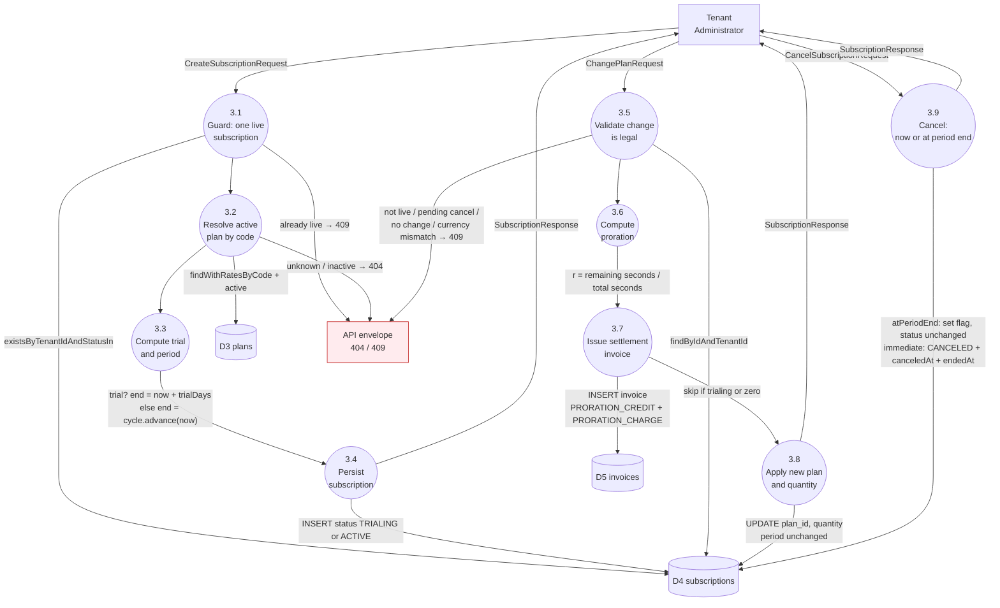

**Create — step by step**

| Step | Action | Failure mode |
|---|---|---|
| 3.1 | `existsByTenantIdAndStatusIn(tenantId, liveStatuses())` | 409 `SUBSCRIPTION_ALREADY_EXISTS`. Backed by the partial unique index for concurrent requests |
| 3.2 | `findWithRatesByCode(...).filter(Plan::isActive)` | 404 `Active plan` |
| 3.3 | `startsInTrial = !skipTrial && plan.trialDays > 0` | — |
| 3.3a | If trialing: `trialEnd = now + trialDays`, `currentPeriodEnd = trialEnd` | The trial **is** the first period; it ends when the first real invoice becomes due |
| 3.3b | Else `currentPeriodEnd = billingCycle.advance(now)` | Calendar arithmetic (`plusMonths`), not fixed days — a cycle starting on the 31st lands on the last day of a shorter month instead of drifting |
| 3.4 | Insert with `status = TRIALING` or `ACTIVE`, `cancelAtPeriodEnd = false` | — |

**Change plan — step by step**

| Step | Action | Detail |
|---|---|---|
| 3.5a | Load via `findByIdAndTenantId` | 404 if absent **or owned by another tenant** — deliberately not 403, which would confirm the id exists elsewhere |
| 3.5b | Reject if `!isLive()` | 409 `SUBSCRIPTION_NOT_LIVE` |
| 3.5c | Reject if `cancelAtPeriodEnd` | 409 `SUBSCRIPTION_PENDING_CANCELLATION` |
| 3.5d | Reject same plan **and** same quantity | 409 `NO_CHANGE_REQUESTED` |
| 3.5e | Reject currency change | 409 `CURRENCY_MISMATCH` — crossing currencies mid-period needs an FX rate and a policy for which rate applies to the credit; refuse rather than guess |
| 3.6 | `ProrationCalculator.calculate(sub, newPlan, newQty, now)` | Skipped entirely while `TRIALING` — nothing has been charged, so there is nothing to credit |
| 3.7 | If non-zero: assemble invoice over `[now, currentPeriodEnd)` | Separate document from the periodic bill, so the recurring invoice stays a clean statement of the period |
| 3.8 | `setPlan`, `setQuantity` | **Period boundaries do not move.** A different billing cycle takes effect at renewal |

**Proration formula**

```
r      = (periodEnd − effectiveAt) / (periodEnd − periodStart)   clamped to [0, 1]
credit = oldPrice × oldQuantity × r        → written as a NEGATIVE line
charge = newPrice × newQuantity × r        → written as a POSITIVE line
net    = charge − credit                   → positive on upgrade, negative on downgrade
```

| Decision | Reason |
|---|---|
| `BigDecimal` throughout | `double` cannot represent 0.1 exactly; a cent lost per proration is a reconciliation problem that surfaces months later |
| Ratio keeps 16 significant digits | Rounding `r` to the money scale first would distort every derived amount. Rounding happens **once**, per final line |
| Elapsed **seconds**, not days | Day-granularity truncation silently favours whichever side it falls on, and breaks across leap days |
| Credit and charge stay **separate lines** | A single netted figure is impossible for a customer, or an auditor, to verify |
| Ratio clamped to `[0, 1]` | Clock skew between instances could otherwise refund more than the customer paid |

**Cancel — step by step**

| Mode | State change | Rationale |
|---|---|---|
| `atPeriodEnd = true` | `cancelAtPeriodEnd = true`; status **unchanged** | The customer keeps service already paid for; renewal simply does not happen, so no refund is due |
| `atPeriodEnd = false` | `status = CANCELED`, `canceledAt = now`, `endedAt = now` | Service stops immediately. **No credit note** is issued for the unused remainder (documented limitation) |

---

### 11.4 DFD Level 2.4 — Usage capture (producer side)

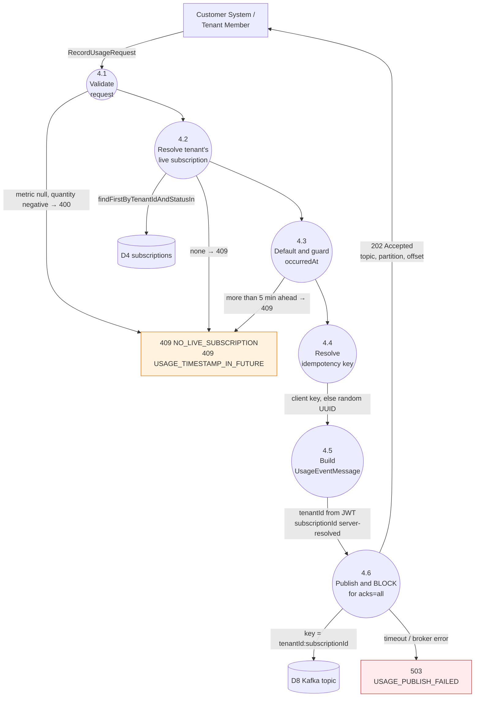

**Step by step**

| Step | Action | Detail |
|---|---|---|
| 4.1 | Bean Validation | `metric` required, `quantity >= 0` with `@Digits(15,4)` |
| 4.2 | `findFirstByTenantIdAndStatusIn(tenantId, liveStatuses())` | The subscription is **resolved server-side**, never accepted from the client — that is what removes cross-tenant validation from every write path |
| 4.3 | `occurredAt = request.occurredAt ?: now` | Rejected beyond 5 minutes in the future: a far-future timestamp would park usage in a period that has not started, quietly removing revenue from the current invoice |
| 4.4 | Client key, or a server-generated UUID | A server key still guarantees exactly-once *processing* of this publish, but cannot deduplicate a client that retries the HTTP call — hence the documentation nudge to supply one |
| 4.5 | `UsageEventMapper.toMessage` | `tenantId` from the verified JWT, `subscriptionId` from 4.2 |
| 4.6 | `kafkaTemplate.send(...).get(10s)` | **Synchronous by design** — see below |

**Why the send blocks.** Usage is revenue. Answering `202 Accepted` for a record that never
reached a broker would silently under-bill the customer, and the client has no way to discover
the loss. Blocking until `acks=all` confirms the write turns a failure into a retryable `503`
while it can still be retried safely — the idempotency key makes that retry harmless. The cost
is request latency bounded by 10 s; a high-throughput ingest path would instead batch
asynchronously behind a durable local write-ahead log.

**Why the partition key is `tenantId:subscriptionId`.** All events for one subscription land on
a single partition. That gives per-subscription ordering and, more importantly, means
concurrent consumer threads never contend on the same `usage_counters` row.

---

### 11.5 DFD Level 2.5 — Usage ingestion (consumer side)

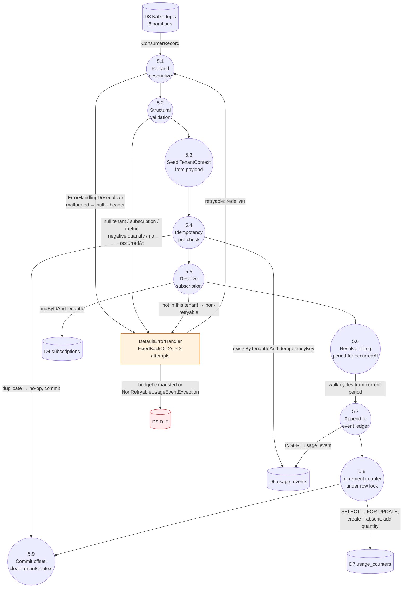

**Step by step**

| Step | Action | Detail |
|---|---|---|
| 5.1 | Listener container polls; `ErrorHandlingDeserializer` wraps `JsonDeserializer` | Without the wrapper a malformed payload throws **inside the poll loop**, before any error handler can see it, and the consumer retries the same offset forever — the classic "poison pill stalls the partition" outage |
| 5.2 | `validate(...)` | Missing tenant/subscription/metric, negative quantity, or absent `occurredAt` → `NonRetryableUsageEventException`. These will never become valid, so spending the retry budget only delays every other record on the partition |
| 5.3 | `TenantContextHolder.setTenantId(message.tenantId())` | The consumer thread never passed through the auth filter; the payload is the only tenancy source |
| 5.4 | `existsByTenantIdAndIdempotencyKey` | Cheap fast path. The **guarantee** is the unique constraint, which also covers two simultaneous in-flight deliveries |
| 5.5 | `findByIdAndTenantId` | A subscription not in this tenant will not appear on retry → non-retryable |
| 5.6 | `BillingPeriodResolver.resolve(subscription, occurredAt)` | See below |
| 5.7 | Insert `UsageEvent` | Records both clocks: `occurredAt` (billable) and `recordedAt` (durability) |
| 5.8 | `findBy...(PESSIMISTIC_WRITE)` or create, then `increment` | A pessimistic lock serialises contended increments; optimistic locking would surface as a stream of retryable failures on a hot row |
| 5.9 | Listener returns → container commits offset; `finally` clears the context | At-least-once delivery. **Mandatory clear** — listener threads are pooled and long-lived |

Steps 5.7 and 5.8 are **one transaction**. Writing the event without incrementing the counter
under-bills; incrementing without recording the event leaves a total nobody can explain.

**Billing period resolution (step 5.6).** Usage is billed to the period in which it *occurred*,
not the one it was ingested in. Consumer lag, a client batching yesterday's meter readings, or
a DLT replay can all deliver an event predating the current window.

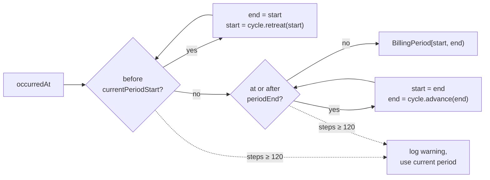

Periods are **half-open** `[start, end)`, which is what makes consecutive periods tile without
overlap — an event exactly on a boundary is billed once, not twice. The 120-step bound stops a
nonsensical timestamp (epoch zero, far future) from spinning.

---

### 11.6 DFD Level 2.6 — Invoicing

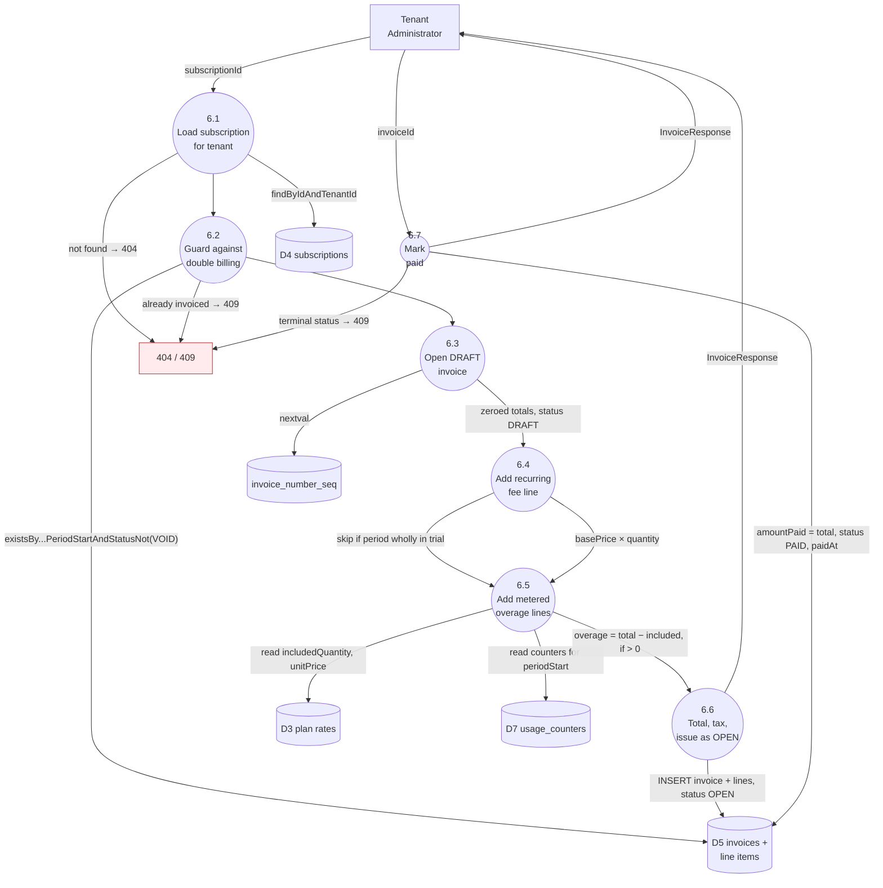

**Step by step**

| Step | Action | Detail |
|---|---|---|
| 6.1 | `findByIdAndTenantId` | Tenant-scoped by construction |
| 6.2 | Duplicate guard | A non-`VOID` invoice covering the same `periodStart` blocks a second. The operation is externally triggered, so a retried request must not produce a duplicate bill. Proration invoices use `periodStart = effectiveAt`, so they never collide with the periodic one |
| 6.3 | `openInvoice` | `DRAFT` with zeroed totals — a partially assembled document can never be mistaken for a payable one. Number from the DB sequence, so concurrent runs cannot collide (gaps from rollbacks are acceptable in an invoice series) |
| 6.4 | `addSubscriptionLine` | Skipped when the trial covers the whole period. Metered overage is still charged in that case |
| 6.5 | `addUsageLines` | One line per metric **in overage**. Metrics inside their allowance produce **no line at all** — an invoice should list what is being charged; full consumption is on the summary endpoint. Metrics the plan does not price are free |
| 6.6 | `finalise` | `subtotal = Σ rounded line amounts`; `tax` only on a positive subtotal; `status = OPEN`, `issuedAt = now`, `dueAt = now + invoiceDueDays` |
| 6.7 | `markPaid` | Rejects terminal statuses (`PAID`, `VOID`, `UNCOLLECTIBLE`) with 409 |

**Rounding discipline.** Each line is rounded once, as it is created, and the invoice total is
the sum of already-rounded lines. Summing unrounded lines and rounding at the end produces a
total that does not equal the visible lines — indefensible on a customer-facing document.

**No negative tax.** A net-credit invoice (the usual outcome of a downgrade) must not generate
negative tax; that is a tax authority's problem to settle, not something an application invents.

**Worked example** — PRO plan, quantity 2, 612,500 API calls against a 500,000 allowance at
`$0.000150`:

| Line | Quantity | Unit price | Amount |
|---|---|---|---|
| `SUBSCRIPTION` — Professional | 2 | 99.0000 | **198.00** |
| `USAGE` — API_CALLS overage | 112,500 | 0.000150 | **16.88** |
| | | Subtotal | **214.88** |
| | | Tax @ 0% | 0.00 |
| | | **Total** | **214.88** |

---

## 12. Sequence diagrams

### 12.1 Tenant registration

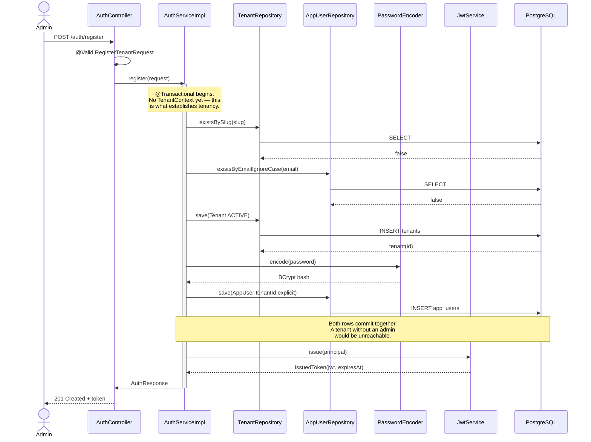

### 12.2 Authenticated request — tenant context lifecycle

```mermaid
sequenceDiagram
    actor Client
    participant F as JwtAuthenticationFilter
    participant JS as JwtService
    participant TC as TenantContextHolder
    participant SC as SecurityContextHolder
    participant CTRL as Controller
    participant TX as TransactionInterceptor
    participant ASP as TenantFilterAspect
    participant SVC as ServiceImpl
    participant HB as Hibernate Session
    participant DB as PostgreSQL

    Client->>F: GET /subscriptions<br/>Authorization: Bearer ...
    activate F
    F->>F: extractBearerToken
    F->>JS: parse(token)
    JS->>JS: verify signature, issuer, exp<br/>(injected clock)
    JS-->>F: AppUserPrincipal(userId, tenantId, role)
    F->>SC: setAuthentication
    F->>TC: setTenantId(tenantId)

    F->>CTRL: doFilter
    CTRL->>TX: list(pageable)
    activate TX
    Note over TX: order = 0 → OUTERMOST.<br/>Transaction and Session open here.
    TX->>ASP: proceed
    activate ASP
    Note over ASP: @Order(100) → runs INSIDE the tx
    ASP->>TC: requireTenantId()
    TC-->>ASP: tenantId
    ASP->>HB: enableFilter("tenantFilter")<br/>.setParameter(tenantId)
    ASP->>SVC: proceed
    activate SVC
    SVC->>DB: SELECT ... WHERE tenant_id = $1<br/>AND tenant_id = $2
    Note over SVC,DB: $1 = Hibernate filter<br/>$2 = ...AndTenantId predicate
    DB-->>SVC: rows (this tenant only)
    SVC-->>ASP: PageResponse
    deactivate SVC
    deactivate ASP
    TX-->>CTRL: commit
    deactivate TX
    CTRL-->>F: 200 OK

    Note over F: finally — MANDATORY
    F->>TC: clear()
    F->>SC: clearContext()
    deactivate F
    F-->>Client: 200 OK
```

### 12.3 Usage reporting — producer

```mermaid
sequenceDiagram
    actor Sys as Customer System
    participant UC as UsageController
    participant US as UsageServiceImpl
    participant SR as SubscriptionRepository
    participant MAP as UsageEventMapper
    participant PROD as UsageEventProducer
    participant K as Kafka Broker

    Sys->>UC: POST /usage/events
    UC->>US: record(request)
    activate US
    US->>US: TenantContextHolder.requireTenantId()
    US->>SR: findFirstByTenantIdAndStatusIn(live)
    SR-->>US: Subscription
    alt no live subscription
        US-->>Sys: 409 NO_LIVE_SUBSCRIPTION
    end
    US->>US: occurredAt = request ?: now
    alt occurredAt > now + 5 min
        US-->>Sys: 409 USAGE_TIMESTAMP_IN_FUTURE
    end
    US->>US: idempotencyKey = client ?: UUID
    US->>MAP: toMessage(request, tenantId, subId, occurredAt, key)
    MAP-->>US: UsageEventMessage
    US->>PROD: publish(message)
    activate PROD
    PROD->>K: send(key = tenant:subscription)<br/>acks = all
    Note over PROD,K: BLOCKS up to 10s.<br/>Acking usage that was never<br/>durably stored would under-bill.
    alt broker acknowledges
        K-->>PROD: RecordMetadata(partition, offset)
        PROD-->>US: SendResult
        US-->>UC: UsageAcceptedResponse
        UC-->>Sys: 202 Accepted
    else timeout / error
        K--xPROD: failure
        PROD-->>Sys: 503 USAGE_PUBLISH_FAILED<br/>(retry with same key)
    end
    deactivate PROD
    deactivate US
```

### 12.4 Usage ingestion — consumer

```mermaid
sequenceDiagram
    participant K as Kafka Broker
    participant LC as Listener Container
    participant CON as UsageEventConsumer
    participant TC as TenantContextHolder
    participant IS as UsageIngestionServiceImpl
    participant ER as UsageEventRepository
    participant SR as SubscriptionRepository
    participant BPR as BillingPeriodResolver
    participant CR as UsageCounterRepository
    participant EH as DefaultErrorHandler
    participant DLT as Dead Letter Topic

    K->>LC: poll → ConsumerRecord
    LC->>LC: ErrorHandlingDeserializer
    LC->>CON: onUsageEvent(message, partition, offset)
    activate CON
    CON->>CON: validate(message)
    alt structurally invalid
        CON->>EH: NonRetryableUsageEventException
        EH->>DLT: publish immediately
        Note over EH,DLT: Registered as not-retryable:<br/>it will never become valid.
    end

    CON->>TC: setTenantId(message.tenantId)
    CON->>IS: ingest(message)
    activate IS
    Note over IS: @Transactional begins

    IS->>ER: existsByTenantIdAndIdempotencyKey
    alt already applied
        ER-->>IS: true
        IS-->>CON: return (no-op)
        Note over IS: At-least-once redelivery absorbed
    end

    IS->>SR: findByIdAndTenantId(subId, tenantId)
    alt not in this tenant
        IS->>EH: NonRetryableUsageEventException
        EH->>DLT: publish
    end
    SR-->>IS: Subscription

    IS->>BPR: resolve(subscription, occurredAt)
    BPR-->>IS: BillingPeriod[start, end)

    IS->>ER: save(UsageEvent)
    Note over IS,ER: Unique (tenant_id, idempotency_key)<br/>is the real guarantee

    IS->>CR: findBy...(PESSIMISTIC_WRITE)
    alt counter absent
        IS->>CR: saveAndFlush(new counter, total = 0)
    end
    IS->>CR: counter.increment(quantity)
    Note over IS,CR: Both writes commit together
    deactivate IS

    CON->>TC: clear()  [finally — pooled threads]
    deactivate CON
    LC->>K: commit offset (AckMode.RECORD)
```

### 12.5 Mid-period upgrade with proration

```mermaid
sequenceDiagram
    actor Admin
    participant SC as SubscriptionController
    participant SS as SubscriptionServiceImpl
    participant PR as PlanRepository
    participant PC as ProrationCalculator
    participant IA as InvoiceAssembler
    participant IR as InvoiceRepository
    participant DB as PostgreSQL

    Admin->>SC: POST /subscriptions/{id}/change-plan
    SC->>SS: changePlan(id, request)
    activate SS
    SS->>DB: findByIdAndTenantId
    DB-->>SS: Subscription (PRO, qty 2)

    SS->>SS: guard: live? not pending cancel?<br/>actually changing? same currency?
    SS->>PR: findWithRatesByCode("ENTERPRISE")
    PR-->>SS: Plan

    alt prorate && not trialing
        SS->>PC: calculate(sub, newPlan, newQty, now)
        activate PC
        PC->>PC: r = remaining sec / total sec, clamp [0,1]
        PC->>PC: credit = oldPrice × oldQty × r
        PC->>PC: charge = newPrice × newQty × r
        PC-->>SS: ProrationResult(credit, charge, net, r)
        deactivate PC

        alt result is non-zero
            SS->>IA: openInvoice(sub, now, currentPeriodEnd)
            IA->>IR: nextInvoiceSequenceValue()
            IR->>DB: SELECT nextval
            IA-->>SS: DRAFT invoice
            SS->>IA: addProrationLines(...)
            Note over IA: CREDIT written NEGATIVE,<br/>CHARGE written POSITIVE.<br/>Both lines always kept.
            SS->>IA: finalise(invoice)
            Note over IA: subtotal = Σ rounded lines<br/>tax only if subtotal > 0
            SS->>IR: save(invoice)
            IR->>DB: INSERT invoice + 2 lines
        end
    else trialing
        Note over SS: Skip — nothing charged yet,<br/>so nothing to credit
    end

    SS->>SS: setPlan(newPlan) then setQuantity(newQty)
    Note over SS: Period boundaries UNCHANGED.<br/>New cycle applies at renewal.
    SS->>DB: UPDATE subscriptions (optimistic version check)
    SS-->>SC: SubscriptionResponse
    deactivate SS
    SC-->>Admin: 200 OK
```

### 12.6 Invoice generation

```mermaid
sequenceDiagram
    actor Admin
    participant IC as InvoiceController
    participant IS as InvoiceServiceImpl
    participant SR as SubscriptionRepository
    participant IR as InvoiceRepository
    participant CR as UsageCounterRepository
    participant IA as InvoiceAssembler
    participant DB as PostgreSQL

    Admin->>IC: POST /invoices/generate?subscriptionId=...
    IC->>IS: generateForCurrentPeriod(id)
    activate IS
    IS->>SR: findByIdAndTenantId
    SR-->>IS: Subscription + Plan + rates

    IS->>IR: existsBy...PeriodStartAndStatusNot(VOID)
    alt already invoiced
        IR-->>IS: true
        IS-->>Admin: 409 PERIOD_ALREADY_INVOICED
    end

    IS->>IA: openInvoice(sub, periodStart, periodEnd)
    IA->>IR: nextInvoiceSequenceValue()
    IA-->>IS: Invoice(DRAFT, INV-000042)

    alt period not wholly within trial
        IS->>IA: addSubscriptionLine(invoice, sub)
        Note over IA: basePrice × quantity, rounded once
    end

    IS->>CR: findAllByTenantIdAndSubscriptionIdAndPeriodStart
    CR->>DB: SELECT counters
    DB-->>CR: [API_CALLS 612500]
    IS->>IA: addUsageLines(invoice, sub, counters)
    Note over IA: overage = 612500 − 500000 = 112500<br/>112500 × 0.000150 = 16.875 → 16.88<br/>metrics within allowance produce no line

    IS->>IA: finalise(invoice)
    Note over IA: subtotal 214.88, tax 0.00,<br/>total 214.88, status OPEN,<br/>dueAt = now + 14 days

    IS->>IR: save(invoice)
    IR->>DB: INSERT invoice + line items
    IS-->>IC: InvoiceResponse
    deactivate IS
    IC-->>Admin: 201 Created
```

---

## 13. State machines

### 13.1 Subscription lifecycle

```mermaid
stateDiagram-v2
    [*] --> TRIALING : create with plan.trialDays > 0<br/>and skipTrial = false
    [*] --> ACTIVE : create with skipTrial = true<br/>or plan has no trial

    TRIALING --> ACTIVE : trial ends, first payment succeeds
    TRIALING --> CANCELED : cancel(atPeriodEnd = false)
    TRIALING --> EXPIRED : trial ends, not converted

    ACTIVE --> ACTIVE : changePlan()<br/>period boundaries unchanged
    ACTIVE --> PAST_DUE : invoice unpaid past due date
    ACTIVE --> CANCELED : cancel(atPeriodEnd = false)
    ACTIVE --> EXPIRED : cancelAtPeriodEnd = true<br/>and period elapses

    PAST_DUE --> ACTIVE : payment received
    PAST_DUE --> CANCELED : cancel or dunning exhausted

    CANCELED --> [*]
    EXPIRED --> [*]

    note right of TRIALING
        isLive() = true
        Occupies the tenant's single
        live-subscription slot.
        Proration is skipped here.
    end note

    note right of PAST_DUE
        isLive() = true
        Still counts against the
        partial unique index.
    end note

    note right of CANCELED
        Terminal. canceledAt and
        endedAt both set.
        No credit note issued for
        the unused remainder.
    end note
```

`cancelAtPeriodEnd` is a **flag, not a state**. A subscription scheduled for cancellation stays
`ACTIVE` — the customer keeps service already paid for — and simply is not renewed.

### 13.2 Invoice lifecycle

```mermaid
stateDiagram-v2
    [*] --> DRAFT : openInvoice()<br/>zeroed totals, not payable

    DRAFT --> OPEN : finalise()<br/>totals computed, issuedAt + dueAt set
    DRAFT --> VOID : cancelled before issue

    OPEN --> PAID : markPaid()<br/>amountPaid = total, paidAt set
    OPEN --> VOID : issued in error
    OPEN --> UNCOLLECTIBLE : written off after dunning

    PAID --> [*]
    VOID --> [*]
    UNCOLLECTIBLE --> [*]

    note right of DRAFT
        isTerminal() = false
        Only DRAFT and OPEN may
        still be mutated.
    end note

    note right of VOID
        The double-billing guard
        ignores VOID invoices, so a
        voided period can be re-billed.
    end note
```

---

## 14. Multi-tenant isolation walkthrough

Every step from an inbound token to a tenant-scoped row.

```mermaid
flowchart TB
    S1["1 — Client sends<br/>Authorization: Bearer &lt;jwt&gt;"]
    S2["2 — JwtAuthenticationFilter<br/>extracts the token"]
    S3["3 — JwtService verifies signature,<br/>issuer and expiry BEFORE reading claims"]
    S4["4 — tid claim → AppUserPrincipal.tenantId"]
    S5["5 — TenantContextHolder.setTenantId<br/>(plain ThreadLocal, not inheritable)"]
    S6["6 — TransactionInterceptor (order 0)<br/>opens tx + Hibernate Session"]
    S7["7 — TenantFilterAspect (order 100)<br/>runs INSIDE the transaction"]
    S8["8 — session.enableFilter('tenantFilter')<br/>.setParameter(tenantId)"]
    S9["9 — Repository method also passes<br/>tenantId explicitly"]
    S10["10 — SQL: WHERE tenant_id = $1 AND tenant_id = $2"]
    S11["11 — Writes: @PrePersist stamps tenantId;<br/>column is updatable = false"]
    S12["12 — Schema: FK + composite unique<br/>constraints reject cross-tenant rows"]
    S13["13 — finally: TenantContextHolder.clear()<br/>and SecurityContextHolder.clearContext()"]

    S1 --> S2 --> S3 --> S4 --> S5 --> S6 --> S7 --> S8 --> S9 --> S10 --> S11 --> S12 --> S13

    N1["A caller cannot name a tenant:<br/>no tenant header, path segment<br/>or body field exists anywhere"]
    N2["Cross-tenant reads answer 404,<br/>never 403 — 403 would confirm<br/>the id exists in another tenant"]
    N3["Threads are pooled. Without step 13<br/>the next request on this thread<br/>inherits a stale tenant."]

    S4 -.-> N1
    S10 -.-> N2
    S13 -.-> N3

    style N1 fill:#e8f5e9,stroke:#2e7d32
    style N2 fill:#e8f5e9,stroke:#2e7d32
    style N3 fill:#ffebee,stroke:#c62828
```

### Deliberate exceptions — where no tenant is bound

| Operation | Why it runs unfiltered | What keeps it safe |
|---|---|---|
| `POST /auth/register` | No tenant exists yet | Scoped by globally unique slug and e-mail |
| `POST /auth/login` | The tenant is not known until the user is found | E-mail is globally unique (`uk_app_users_email`) |
| `GET /plans` | Platform catalogue, not tenant data | Plans carry no `tenant_id` at all |
| Renewal job (not wired) | Operates across every tenant by design | Would use `TenantContextHolder.runAs` per tenant |

`TenantFilterAspect` intentionally no-ops when no tenant is bound **or** no transaction is
active. Unwrapping a `Session` outside a transaction would open a short-lived one that the
subsequent transaction discards — setting the filter on the wrong session.

---

## 15. Application startup sequence

```mermaid
sequenceDiagram
    participant JVM
    participant SB as Spring Boot
    participant CP as @ConfigurationProperties
    participant FW as Flyway
    participant HB as Hibernate
    participant KA as KafkaAdmin
    participant LC as Listener Container

    JVM->>SB: SubscriptionManagerApplication.main
    SB->>CP: bind app.security / app.billing / app.kafka
    Note over CP: @Validated records.<br/>A missing or invalid value aborts<br/>startup, not the first request.
    CP-->>SB: SecurityProperties, BillingProperties,<br/>KafkaTopicProperties

    SB->>SB: JwtService constructor
    Note over SB: Key < 256 bits → IllegalStateException.<br/>Weak signing material must never<br/>reach production traffic.

    SB->>FW: migrate()
    FW->>FW: V1__init_schema.sql
    FW->>FW: V2__seed_plan_catalogue.sql
    FW-->>SB: schema at version 2

    SB->>HB: build SessionFactory
    HB->>HB: ddl-auto = validate
    Note over HB: Mapping vs schema mismatch<br/>aborts startup. This caught a real<br/>CHAR(3) vs varchar(3) defect.
    HB->>HB: register @FilterDef "tenantFilter"
    HB-->>SB: EntityManagerFactory

    SB->>KA: declare NewTopic beans
    KA->>KA: billing.usage-events.v1 (6 partitions)
    KA->>KA: billing.usage-events.v1.DLT (1 partition)

    SB->>LC: start listener containers
    LC->>LC: join group, 3 consumers,<br/>partitions assigned
    LC-->>SB: running

    SB-->>JVM: /actuator/health/readiness = UP
```

**Fail-fast order.** Configuration binding → key strength → schema migration → mapping
validation → topic declaration → consumer start. Every gate that can detect a misconfiguration
does so before the application accepts a single request.

---

## 16. Error handling flow

```mermaid
flowchart TB
    EX["Exception thrown"]

    EX --> Q1{"Type?"}

    Q1 -->|"ApplicationException"| A1["Status + errorCode<br/>carried on the exception"]
    Q1 -->|"MethodArgumentNotValid<br/>ConstraintViolation"| A2["400 VALIDATION_FAILED<br/>+ fieldErrors map"]
    Q1 -->|"HttpMessageNotReadable<br/>TypeMismatch<br/>MissingParameter"| A3["400 MALFORMED_REQUEST"]
    Q1 -->|"NoResourceFound"| A4["404 ENDPOINT_NOT_FOUND"]
    Q1 -->|"MethodNotSupported"| A5["405 + supportedMethods"]
    Q1 -->|"MediaTypeNotSupported"| A6["415"]
    Q1 -->|"AuthenticationException"| A7["401 AUTHENTICATION_FAILED"]
    Q1 -->|"AccessDeniedException"| A8["403 ACCESS_DENIED"]
    Q1 -->|"OptimisticLockingFailure"| A9["409 CONCURRENT_MODIFICATION<br/>caller may retry"]
    Q1 -->|"DataIntegrityViolation"| A10["409 DATA_INTEGRITY_VIOLATION"]
    Q1 -->|"anything else"| A11["500 INTERNAL_ERROR<br/>+ generated errorId"]

    A1 --> PD["ApiResponse with success=false"]
    A2 --> PD
    A3 --> PD
    A4 --> PD
    A5 --> PD
    A6 --> PD
    A7 --> PD
    A8 --> PD
    A9 --> PD
    A10 --> PD
    A11 --> PD

    PD --> OUT["type · title · status · detail<br/>instance · errorCode · timestamp"]

    SEC["Security filter chain<br/>failures"] -->|"HandlerExceptionResolver"| Q1
    Note1["Routing security failures back through<br/>MVC keeps ONE error format —<br/>not a second, divergent one."]
    SEC -.-> Note1

    A11 --> LOG["Stack trace logged with errorId.<br/>Never returned — no SQL, entity<br/>names or traces reach the client."]

    style A11 fill:#ffebee,stroke:#c62828
    style Note1 fill:#e8f5e9,stroke:#2e7d32
```

### Exception hierarchy

```mermaid
classDiagram
    class RuntimeException {
        <<Java>>
    }
    class ApplicationException {
        <<abstract>>
        -HttpStatus status
        -String errorCode
    }
    class ResourceNotFoundException {
        404 RESOURCE_NOT_FOUND
    }
    class BusinessRuleException {
        409 BUSINESS_RULE_VIOLATION
    }
    class DuplicateResourceException {
        409 RESOURCE_ALREADY_EXISTS
    }
    class TenantContextMissingException {
        500 TENANT_CONTEXT_MISSING
    }
    class PublishFailedException {
        503 USAGE_PUBLISH_FAILED
    }

    RuntimeException <|-- ApplicationException
    ApplicationException <|-- ResourceNotFoundException
    ApplicationException <|-- BusinessRuleException
    ApplicationException <|-- DuplicateResourceException
    ApplicationException <|-- TenantContextMissingException
    ApplicationException <|-- PublishFailedException
```

Carrying status and a stable `errorCode` **on the exception** lets one handler render every
failure consistently, instead of a growing chain of `instanceof` checks.

`TenantContextMissingException` maps to **500, not 401** — deliberately. It means tenant-scoped
work was attempted with no tenant bound, which is a *bug* (a service called outside the request
scope, or a listener that forgot to seed the context), not a client error. The engine fails
closed rather than silently querying across every tenant.

---

## 17. Data dictionary

### Principal data flows

| Flow | From → To | Payload |
|---|---|---|
| `RegisterTenantRequest` | Admin → 1.0 | tenantName, slug, adminEmail, adminFullName, adminPassword |
| `AuthResponse` | 1.0/2.0 → Client | accessToken, tokenType, expiresAt, userId, tenantId, tenantSlug, role |
| `CreateSubscriptionRequest` | Admin → 3.0 | planCode, quantity, skipTrial |
| `ChangePlanRequest` | Admin → 3.0 | planCode, quantity?, prorate? |
| `CancelSubscriptionRequest` | Admin → 3.0 | atPeriodEnd, reason |
| `SubscriptionResponse` | 3.0 → Admin | id, tenantId, plan fields, status, quantity, period window, trialEnd, cancel flags, audit stamps |
| `RecordUsageRequest` | System → 4.0 | metric, quantity, occurredAt?, idempotencyKey?, source? |
| `UsageEventMessage` | 4.0 → D8 → 5.0 | tenantId, subscriptionId, metric, quantity, idempotencyKey, source, occurredAt |
| `UsageAcceptedResponse` | 4.0 → System | subscriptionId, metric, quantity, occurredAt, idempotencyKey, topic, partition, offset |
| `UsageSummaryResponse` | 6.0 → Member | subscriptionId, planCode, period window, currency, per-metric summaries, estimatedOverageTotal |
| `InvoiceResponse` | 6.0 → Admin | id, subscriptionId, invoiceNumber, status, currency, subtotal, taxAmount, total, amountPaid, amountDue, period, issuedAt, dueAt, paidAt, lineItems |
| `ApiResponse` | any → Client | success, message, data { errorCode, path, timestamp, optional fieldErrors / errorId } |

### Data stores

| ID | Store | Kind | Retention |
|---|---|---|---|
| D1 | `tenants` | Relational, permanent | Indefinite |
| D2 | `app_users` | Relational, permanent | Indefinite |
| D3 | `plans`, `plan_metered_rates` | Relational, reference data | Migration-managed |
| D4 | `subscriptions` | Relational, mutable aggregate | Indefinite |
| D5 | `invoices`, `invoice_line_items` | Relational, immutable once issued | Indefinite (financial record) |
| D6 | `usage_events` | Relational, append-only ledger | Indefinite; grows fastest |
| D7 | `usage_counters` | Relational, roll-up | One row per subscription × metric × period |
| D8 | `billing.usage-events.v1` | Kafka topic, 6 partitions | 7 days (`app.kafka.usage-events.retention`) |
| D9 | `billing.usage-events.v1.DLT` | Kafka topic, 1 partition | 7 days |

### Configuration inputs

| Prefix | Binding type | Controls |
|---|---|---|
| `app.security` | `SecurityProperties` | JWT secret, issuer, TTL, clock skew, claim names, public paths |
| `app.billing` | `BillingProperties` | Currency, money/usage scale, rounding mode, proration toggle, tax rate, invoice terms |
| `app.kafka` | `KafkaTopicProperties` | Topic name, partitions, replicas, retention, retry budget, DLT suffix |

All three are `@Validated` records bound by constructor. **No `@Value` appears anywhere in the
codebase** — a misconfigured environment fails at startup rather than at the first request that
happens to need the missing value.

---

## 18. Cross-references to source

| Concern | Where it lives |
|---|---|
| Tenant discriminator + write stamp | `entity/TenantAwareEntity.java` |
| Filter activation and advice ordering | `security/TenantFilterAspect.java`, `config/JpaConfig.java` |
| Token issue/verify, tenant claim | `security/JwtService.java` |
| Context binding and mandatory clear | `security/JwtAuthenticationFilter.java`, `security/TenantContextHolder.java` |
| Proration arithmetic | `service/billing/ProrationCalculator.java` |
| Invoice assembly and rounding | `service/billing/InvoiceAssembler.java` |
| Late-event period attribution | `service/billing/BillingPeriodResolver.java` |
| Blocking publish + 503 semantics | `messaging/UsageEventProducer.java` |
| Idempotent ingestion | `service/impl/UsageIngestionServiceImpl.java` |
| Poison-pill containment, DLT | `config/KafkaConfig.java` |
| Schema, constraints, indexes | `resources/db/migration/V1__init_schema.sql` |
| Error contract | `common/GlobalExceptionHandler.java` |
